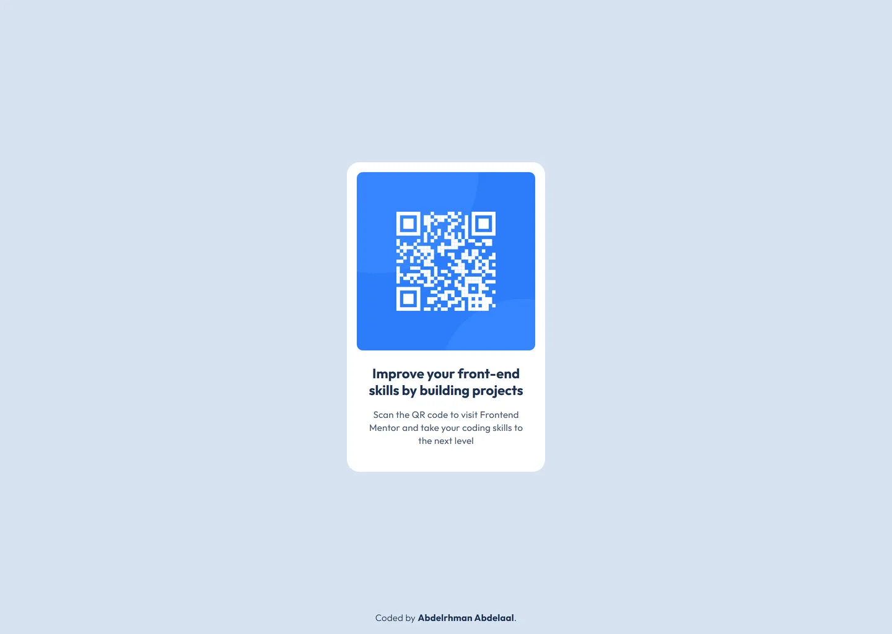

# QR code component

My solution to the [QR code component](https://www.frontendmentor.io/challenges/qr-code-component-iux_sIO_H)
challenge on Frontend Mentor.

- Live: https://qr-code-component.abdelrhman-ahmed8881.workers.dev
- Code: https://github.com/MrBlackvanta/qr-code-component

## Built with

- React and Vite
- TypeScript
- Tailwind CSS

## Notes

A single presentational card component, centred on the page with grid. Nothing here
needs state, so nothing has any.

## Author

- [LinkedIn](https://www.linkedin.com/in/abdelrhman-vanta/)
- [UpWork](https://www.upwork.com/freelancers/mrblackvanta)
- [Frontend Mentor](https://www.frontendmentor.io/profile/MrBlackvanta)
